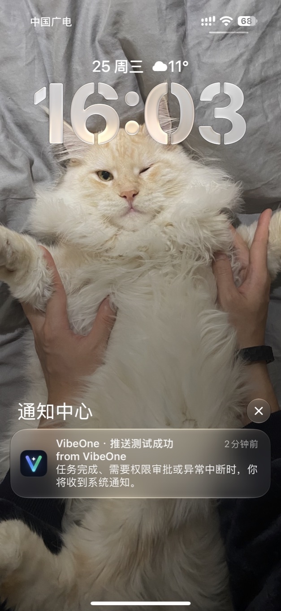

# VibeOne

**在手机上接手电脑上的 AI 编程任务。**

VibeOne 是一个自托管的网页控制台，直连运行在你本机的 **OpenAI Codex CLI** 和 **Antigravity CLI**。出门前让 Agent 开始修 bug 或重构，路上就能用手机查看实时进度、审阅 Git Diff、审批权限并继续发指令；所有代码、会话记录和账号凭证都保留在你自己的电脑上。

<p align="center">
  
  
  
</p>

> 演示界面使用模拟任务数据，另附[静态会话截图](docs/demo/mobile.png)。

---

## 核心特性

- **离开电脑也能继续推进**：手机浏览器支持流式输出、Git Diff 审阅、权限审批和继续对话；iOS 添加到主屏幕后，可在任务完成或等待审批时收到系统级 Web Push 通知。
- **多项目并行管理**：在同一界面切换工作目录和会话，随时查看后台运行中的任务，会话历史保存在本地 SQLite。
- **双引擎多账号秒切**：统一管理 Codex 和 Antigravity 的多个账号，启动时自动后台预热已登录账号，并按账号记住模型与推理设置。
- **基于官方 CLI 本地直连**：本机通过标准输入输出调用 `codex app-server --stdio` 与 `agy acp --stdio`（[Codex 集成指南](https://developers.openai.com/blog/codex-as-a-platform) · [Antigravity ACP 文档](https://antigravity.google/docs/cli/acp/)），使用你自己的 CLI 登录身份，不经过第三方中转服务器。

---

## 快速开始

### 环境要求

- **Python 3.9+**、**Git**
- 至少安装并登录以下 CLI 之一：
  - **OpenAI Codex CLI (`codex`)**：已完成终端登录（`~/.codex` 或 `OPENAI_API_KEY`）
  - **Antigravity CLI (`agy`)**：已完成终端登录（多账号位于 `~/.config/agy/profiles/<name>`）

### 安装并启动

```bash
git clone https://github.com/RokiLai/vibeone.git
cd vibeone

python3 -m venv .venv
.venv/bin/pip install -r requirements.txt

cp .env.example .env
# 编辑 .env，至少将 VIBEONE_WEB_TOKEN 改为高强度随机字符串

./start.sh
```

启动后访问 `http://127.0.0.1:8765`，输入 `VIBEONE_WEB_TOKEN` 即可登录使用。

---

## 手机远程访问与 iPhone 推送

> **安全提示**：VibeOne 面向单用户自托管，登录后可访问本机工作区和已登录的 Agent。请保持默认回环监听（`127.0.0.1:8765`），仅通过私有网络或带访问控制的 HTTPS 代理暴露给受信任的设备。Codex 的 `auto` 模式允许写入工作区和联网，`full-access` 会关闭文件沙箱。

### 方式一：Tailscale（推荐，零域名配置）

1. 在电脑和手机登录同一个 Tailscale 网络，并在管理后台启用 MagicDNS 与 HTTPS 证书。
2. 电脑上启动 VibeOne（保持监听 `127.0.0.1:8765`），另开终端运行：

   ```bash
   tailscale serve --bg http://127.0.0.1:8765
   ```

3. 手机连接 Tailscale 后，访问输出的 `https://…ts.net` 地址并用令牌登录（参考 [Tailscale Serve 文档](https://tailscale.com/docs/reference/tailscale-cli/serve)）。

### 方式二：自有域名 + Caddy

1. 将域名 DNS（`A`/`AAAA`）指向公网入口，确保 TCP 80/443 可到达 Caddy（若宽带为 CGNAT 且无公网 IPv6，请使用上面的 Tailscale 方案）。
2. 复制 [Caddyfile.example](Caddyfile.example) 为 `Caddyfile`，替换为你的域名并按需配置额外的入口访问控制。
3. 分别启动 VibeOne 与 Caddy：

   ```bash
   ./start.sh
   caddy run --config Caddyfile
   ```

   Caddy 会自动签发并续期 TLS 证书（参考 [Caddy 自动 HTTPS](https://caddyserver.com/docs/automatic-https)）。

### 开启 iPhone 推送通知（iOS PWA）

1. 在 `.env` 中设置 `VIBEONE_VAPID_SUBJECT=mailto:your@domain.com`（须为合法域名邮箱，不能用 `@localhost`），重启 VibeOne。
2. 在 iPhone Safari 打开上面的可信 HTTPS 地址，点击分享菜单 → **添加到主屏幕**。
3. 从主屏幕图标打开 VibeOne，在应用设置中启用 Web Push 并允许系统通知。

---

## 环境变量说明

常用配置（完整模板见 [.env.example](.env.example)）：

| 变量名 | 必填 | 默认值 | 说明 |
| --- | --- | --- | --- |
| `VIBEONE_WEB_TOKEN` | 是 | 无 | Web 登录与 API/WS 鉴权令牌 |
| `VIBEONE_HOST` | 否 | `127.0.0.1` | 监听地址 |
| `VIBEONE_PORT` | 否 | `8765` | 监听端口 |
| `VIBEONE_WORKDIR` | 否 | 项目根目录 | 默认打开的工作目录 |
| `VIBEONE_VAPID_SUBJECT` | 否 | `mailto:admin@example.com` | Web Push VAPID 联系邮箱（需合法域名） |

<details>
<summary>展开更多高级配置（权限模式、预热、CLI 路径、LaunchAgent）</summary>

| 变量名 | 默认值 | 说明 |
| --- | --- | --- |
| `VIBEONE_DEFAULT_MODE` | `auto` | 新建/恢复会话时的默认权限模式 |
| `VIBEONE_PREWARM_PROFILES` | `all` | 启动时后台异步预热的账号（`all` / 逗号分隔账号名 / `none`） |
| `VIBEONE_MAX_UPLOAD_BYTES` | `26214400` (25MB) | 单张图片上传大小上限 |
| `VIBEONE_LAUNCHD_LABEL` | `local.vibeone` | macOS LaunchAgent 标识（配合 `.restart_after_turn` 自动重启） |
| `AGY_PROFILE` | 自动探测（优先已登录账号） | 首次启动默认选中的账号 |
| `AGY_PROFILES_DIR` | `~/.config/agy/profiles` | Antigravity 多账号目录 |
| `AGY_BIN` / `AGY_REAL_BIN` | 自动从 `~/.local/bin` 和 `PATH` 查找 | 指定 `agy` 可执行文件路径 |
| `CODEX_BIN` | 自动从 `PATH` / Homebrew 查找 | 指定 `codex` 可执行文件路径 |
| `CODEX_HOME` | `~/.codex` | 指定 Codex 配置目录 |

> 路径查找顺序为「环境变量优先 → `PATH` 与常见目录自动发现」，换机部署无需修改源码。

</details>

---

## 开发与测试

```bash
# 后端语法检查
.venv/bin/python -m py_compile server.py vibeone/*.py vibeone/engines/*.py

# 运行单元测试
.venv/bin/python -m unittest discover -s tests -v
```

- 修改前端文件（`index.html`、`static/*`）刷新浏览器即生效，无需重启后端。
- 修改后端 Python 代码需重启服务；若由 macOS LaunchAgent 托管，可在根目录创建 `.restart_after_turn` 触发当前回合结束后的无损重启。

<details>
<summary>查看项目目录结构</summary>

```text
vibeone/
├── server.py               # FastAPI 入口与 HTTP / WebSocket API
├── start.sh                # 一键启动脚本（自动加载 .env 与 PATH）
├── .env.example            # 环境变量配置模板
├── index.html              # 前端入口页面
├── manifest.json           # PWA Manifest
├── sw.js                   # Service Worker（离线缓存与 Web Push 通知）
├── Caddyfile.example       # Caddy HTTPS 反向代理配置示例
├── requirements.txt        # Python 依赖
├── vibeone/
│   ├── config.py           # 环境变量、二进制路径与多账号配置解析
│   ├── store.py            # SQLite 会话、消息与元数据持久化
│   ├── passkey.py          # WebAuthn / Passkey 生物识别登录
│   ├── auth_flow.py        # 网页内 CLI 账号登录流程管理
│   ├── push.py             # VAPID Web Push 推送管理
│   ├── quota.py            # 账号余量查询
│   └── engines/
│       ├── acp.py          # Antigravity ACP 引擎封装
│       ├── codex.py        # OpenAI Codex App-Server 引擎封装
│       └── pool.py         # 多账号热切换连接池与后台预热
├── static/                 # 前端模块脚本与样式 (app-*.js, app.css)
├── vendor/                 # 本地前端依赖 (Tailwind CSS, marked, highlight.js, DOMPurify)
├── icons/                  # PWA 图标资源
└── tests/                  # 单元测试
```

</details>

---

## 许可证

VibeOne 采用 [MIT 许可证](LICENSE)。随项目分发的第三方前端依赖遵循[各自的许可证](vendor/README.md)。
