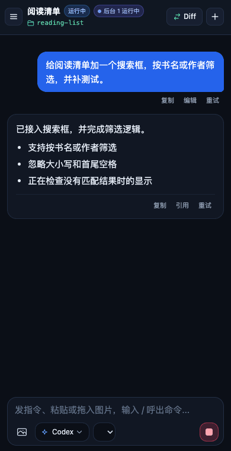
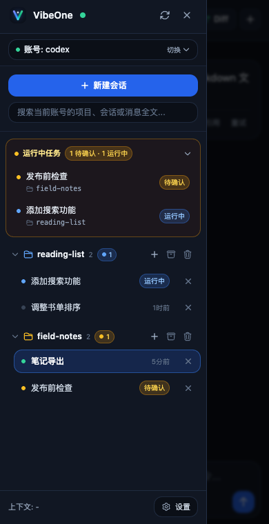

# VibeOne

**在手机上接手电脑上的 AI 编程任务。**

VibeOne 是一个自托管的网页控制台，连接运行在你电脑上的 **Codex CLI** 和 **Antigravity CLI**。比如你出门前让 Codex 修一个 bug，路上可以用手机看它做到哪一步、打开 Git Diff 审阅改动、处理权限请求，再发一条消息让它继续。Agent 在你的电脑上运行，项目文件和 VibeOne 的会话记录保存在本机。

## 演示

打开手机侧边栏，在两个示例项目里找到正在运行的会话。进入后查看进度、展开 Git Diff，再发一条消息让 Agent 补一个空结果提示。

<p>
  
  
</p>

演示使用真实的 VibeOne 界面和模拟任务数据。[查看会话静态截图](docs/demo/mobile.png)。

## 为什么用 VibeOne

- **离开电脑也能接着做。** 手机浏览器可以查看流式输出、审阅 Diff、审批权限和发送后续指令。在 iOS 上添加到主屏幕后，还可以接收任务完成和待审批的 Web Push 通知。
- **多个项目可以同时推进。** 在同一界面切换工作目录和会话，查看后台任务。会话记录保存在本地 SQLite，回来后可以继续之前的上下文。
- **在同一个界面管理两种 CLI。** 支持 Codex 和 Antigravity 的多账号切换，可提前启动已登录的账号，并按账号记住模型和推理设置。

## 安装前需要准备什么

| 使用方式 | 需要准备 |
| --- | --- |
| 只在运行 Agent 的电脑上使用 | Python 3.9+、Git、至少一个已登录的 Codex CLI 或 Antigravity CLI，以及自己生成的 VibeOne 登录令牌。 |
| 用自己的手机远程访问 | 电脑保持开机联网，手机和电脑加入同一个 Tailscale 私有网络。Tailscale Serve 提供 HTTPS 地址，无需自购域名或转发路由器端口。 |
| 通过公网域名访问 | 域名或子域名、指向公网入口的 DNS 记录、可从外网到达的 TCP 80/443、Caddy，以及只允许受信任用户访问的入口控制。 |
| 在 iPhone 接收 Web Push | 手机能访问的可信 HTTPS 地址、部署者的联系邮箱，以及主屏幕应用的通知权限。 |

## 快速开始

### 1. 环境要求

- Python 3.9+
- 至少安装并登录以下 CLI 之一：
  - **Antigravity CLI (`agy`)**：确保已在终端完成登录，多账号配置位于 `~/.config/agy/profiles/<name>`
  - **OpenAI Codex CLI (`codex`)**：确保已在终端完成登录（`~/.codex` 或 `OPENAI_API_KEY`）

### 2. 安装依赖

```bash
git clone https://github.com/RokiLai/vibeone.git
cd vibeone

python3 -m venv .venv
.venv/bin/pip install -r requirements.txt
```

### 3. 配置 `.env`

在项目根目录创建 `.env`（已被 `.gitignore` 忽略）：

```dotenv
# 必填：登录访问密钥（建议使用高强度随机字符串）
VIBEONE_WEB_TOKEN=your-strong-random-token

# 可选：监听地址与端口（默认 127.0.0.1:8765）
VIBEONE_HOST=127.0.0.1
VIBEONE_PORT=8765

# 可选：默认工作目录（默认当前项目目录）
VIBEONE_WORKDIR=/path/to/your/workspace

# 可选：启用 Web Push 时，填写部署者的联系邮箱
# VIBEONE_VAPID_SUBJECT=mailto:admin@example.com
```

### 4. 启动服务

```bash
./start.sh
```

启动后在浏览器访问 `http://127.0.0.1:8765`（或你配置的端口），输入 `VIBEONE_WEB_TOKEN` 即可使用。

## 环境变量说明

| 变量名 | 必填 | 默认值 | 说明 |
| --- | --- | --- | --- |
| `VIBEONE_WEB_TOKEN` | 是 | 无 | Web 登录与 API/WS 鉴权令牌 |
| `VIBEONE_HOST` | 否 | `127.0.0.1` | 监听地址 |
| `VIBEONE_PORT` | 否 | `8765` | 监听端口 |
| `VIBEONE_WORKDIR` | 否 | 项目根目录 | 默认打开的工作目录 |
| `VIBEONE_DEFAULT_MODE` | 否 | `auto` | 新建/恢复会话时的默认权限模式 |
| `VIBEONE_PREWARM_PROFILES` | 否 | `all`（扫描全部已登录账号） | 启动时后台异步启动的账号列表（默认扫描全部已登录账号并并发异步启动，不分主次；也可逗号分隔指定账号，或设为 `none` / `off` 关闭自动启动） |
| `VIBEONE_VAPID_SUBJECT` | 否 | `mailto:admin@example.com` | Web Push VAPID 联系邮箱（需使用合法域名，不能用 `@localhost`） |
| `VIBEONE_MAX_UPLOAD_BYTES` | 否 | `26214400` (25MB) | 单张图片上传大小上限 |
| `VIBEONE_LAUNCHD_LABEL` | 否 | `local.vibeone` | macOS LaunchAgent 服务标识（用于 `.restart_after_turn` 自动重启） |
| `AGY_PROFILE` | 否 | 自动探测（优先 `agy2`） | 首次启动默认选中的账号 |
| `AGY_PROFILES_DIR` | 否 | `~/.config/agy/profiles` | Antigravity 多账号目录 |
| `AGY_BIN` / `AGY_REAL_BIN` | 否 | 自动从 `~/.local/bin` 和 `PATH` 查找 | 指定 `agy` 可执行文件路径 |
| `CODEX_BIN` | 否 | 自动从 `PATH` / Homebrew 查找 | 指定 `codex` 可执行文件路径 |
| `CODEX_HOME` | 否 | `~/.codex` | 指定 Codex 配置目录 |

> 路径查找顺序为「环境变量优先 → `PATH` 与常见目录自动发现」，换机部署无需修改源码。

## HTTPS 远程访问与 iOS PWA

VibeOne 面向单用户自托管。Web 登录后可以访问本机工作区、会话和已登录的 Agent。保留服务的回环监听，通过 VPN 或带访问控制的 HTTPS 代理提供远程访问，仅向受信任的用户和设备开放。Codex 的 `auto` 模式允许写入工作区和联网，无需逐次审批。`full-access` 会关闭 Codex 的文件沙箱。

### 用 Tailscale 从自己的手机访问

1. 在电脑和手机安装并登录 Tailscale，将两台设备加入同一个私有网络。为该网络启用 MagicDNS 和 HTTPS 证书。
2. 在电脑上启动 VibeOne，保留默认监听地址 `127.0.0.1:8765`。在同一台电脑的另一个终端运行：

   ```bash
   tailscale serve --bg http://127.0.0.1:8765
   ```

3. 手机连接 Tailscale 后，打开命令输出的 `https://…ts.net` 地址，再用 VibeOne 的令牌登录。[Tailscale Serve 文档](https://tailscale.com/docs/reference/tailscale-cli/serve)

### 用 Caddy 和域名提供公网 HTTPS

1. 将域名或子域名的 DNS `A` 或 `AAAA` 记录指向公网入口。确认 TCP 80/443 能到达 Caddy。家用路由器通常需要端口转发。如果宽带使用运营商级 NAT（CGNAT）且没有可用的公网 IPv6，单靠路由器转发通常无法建立公网入口，可以使用上面的私有访问方案。
2. 安装 Caddy，把 [Caddyfile.example](Caddyfile.example) 复制成 `Caddyfile`，填入自己的域名，并确保代理端口与 VibeOne 的监听端口一致。公网入口应配置额外的身份验证或 IP 允许列表。示例负责 HTTPS 和反向代理，入口访问控制由部署者配置。
3. 保持 VibeOne 监听在回环地址，只对外开放代理入口。分别启动 VibeOne 和 Caddy：

   ```bash
   ./start.sh
   caddy run --config Caddyfile
   ```

   Caddy 会尝试自动签发并续期证书。[Caddy 自动 HTTPS 前提](https://caddyserver.com/docs/automatic-https)

### 在 iPhone 接收通知

1. 将 `VIBEONE_VAPID_SUBJECT` 设置为部署者的实际联系邮箱，并重启 VibeOne。
2. 在 iPhone Safari 打开可信的 HTTPS 地址，使用分享菜单中的 **添加到主屏幕**。
3. 从主屏幕打开 VibeOne，在设置中启用 Web Push，并允许系统通知。

## 开发与测试

```bash
# 后端语法检查
.venv/bin/python -m py_compile server.py

# 运行单元测试
.venv/bin/python -m unittest discover -s tests -v
```

- 修改前端文件（`index.html`、`static/app.js`、`static/app.css`）刷新浏览器即可生效，无需重启后端。
- 修改后端 Python 代码后需重启服务生效；如果通过 macOS LaunchAgent 托管运行，可在项目根目录创建 `.restart_after_turn` 触发当前回合结束后的无损自动重启。

### 目录结构

```text
vibeone/
├── server.py               # FastAPI 入口与 HTTP / WebSocket API
├── start.sh                # 一键启动脚本（自动加载 .env 与 PATH）
├── index.html              # 前端入口页面
├── manifest.json           # PWA Manifest
├── sw.js                   # Service Worker（Web Push 通知）
├── Caddyfile.example       # Caddy HTTPS 反向代理配置示例
├── requirements.txt        # Python 依赖
├── vibeone/
│   ├── config.py           # 环境变量、二进制路径与多账号配置解析
│   ├── store.py            # SQLite 会话、消息与元数据持久化
│   ├── push.py             # VAPID Web Push 推送管理
│   ├── quota.py            # 账号余量查询
│   └── engines/
│       ├── acp.py          # Antigravity ACP 引擎封装
│       ├── codex.py        # OpenAI Codex App-Server 引擎封装
│       └── pool.py         # 多账号热切换连接池与后台预热
├── static/                 # 前端逻辑与样式 (app.js, app.css)
├── vendor/                 # 本地前端依赖 (marked, highlight.js, DOMPurify)
├── icons/                  # PWA 图标资源
└── tests/                  # 单元测试
```

## 许可证

VibeOne 采用 [MIT 许可证](LICENSE)。随项目分发的第三方依赖遵循[各自的许可证](vendor/README.md)。
